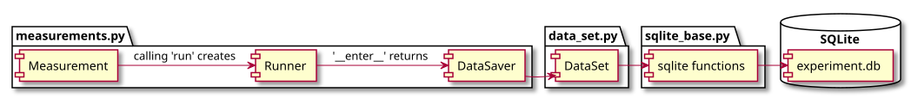

.. highlight:: python

.. _datasetdesign:

==============
Dataset Design
==============

.. _sec:design_introduction:

Introduction
============

.. _datasetdiagram:

   Basic workflow

This document aims to explain the design and working of the
:doc:`QCoDeS DataSet <../examples/DataSet/DataSet-class-walkthrough>`.
In :numref:`datasetdiagram` we sketch the basic design of the dataset.
The dataset implementation is organised in 3 layers shown vertically in
:numref:`datasetdiagram` Each of the layers implements functionality for
reading and writing to the dataset. The layers are organised hierarchically
with the top most one implementing a high level interface and the lowest
layer implementing the communication with the database. This is done in order
to facilitate two competing requirements. On one hand the dataset should
be easy to use enabling simple and easy to use functionality for performing
standard measurements with a minimum of typing. On the other hand the dataset
should enable users to perform any measurement that they may find useful.
It should not force the user into a specific measurement pattern that may be
suboptimal for more advanced use cases. Specifically it should possible to
formulate any experiment as python code using standard language constructs
(for and while loops among others) with a minimal effort.

The legacy QCoDeS dataset ``qcodes.data`` and loop ``qcodes.Loop`` is
primarily oriented towards ease of use for the standard use case but makes
it challenging to formulate more complicated experiments without significant
work reformatting the experiments in a counterintuitive way.

The QCoDeS dataset currently implements two
interfaces directly targeting end users. It is not expected that the user
of QCoDeS will need to interface directly with the lowest layer communicating
with the database.

The ``dataset`` layer defined in the :ref:`dataset-spec` provides the most
flexible user facing layer. Insert reference to notebook. but requires users
to manually register `ParamSpecs`. The dataset implements two functions for
inserting one or more rows of data into the dataset and immediately writes it
to disk. It is, however, the users responsibility to ensure good performance
by writing to disk at suitable intervals.

The measurement context manager layer provides additional support for flushing
data to disk at selected intervals for better performance without manual
intervention. It also provides easy registration of ParamSpecs on
the basis of QCoDeS parameters or custom parameters.

But importantly it does not:

* Automatically infer the relationship between dependent and independent
  parameters. The user must supply this metadata for correct plotting.
* Automatically register parameters.
* Enforce any structure on the measured data. (1D, on a grid ect.)
  This may make plotting more difficult as any structure will have to

It is envisioned that a future layer is added on top of the existing layers
to automatically register parameters and save data at the cost of being
able to write the measurement routine as pure python functions.

We note that the dataset currently exclusively supports storing data in an
SQLite database. This is not an intrinsic limitation of the dataset and
measurement layer. It is possible that at a future state support for writing
to a different backend will be added.

.. _sec:design_snapshot_storage:

Snapshot storage
================

Database schema version 10 permits either legacy JSON TEXT or a versioned BLOB
in ``runs.snapshot``. New snapshot writes default to lossless Zstandard level 1.
To write legacy uncompressed TEXT instead, set::

    qcodes.config.dataset.snapshot_compression = "none"

The other supported value is ``"zstd"`` (the default). This policy applies to
each new write, including overwrites, database copies and imported metadata;
it does not rewrite existing snapshots. Small snapshots are compressed too,
even when the framing overhead makes them larger. Reads recognize both formats
regardless of the current write policy. SQL NULL continues to mean no snapshot.

The BLOB format is the ASCII bytes ``QCoDeS.snapshot``, a NUL byte, a version
byte (currently ``0x01``), then exactly one Zstandard frame with a checksum.
The frame contains the original JSON string encoded as UTF-8. Compression
does not parse or re-encode JSON, drop fields, deduplicate values, or change
NumPy/custom encoder, complex number, uncertainty or non-finite float semantics.
Unknown versions, truncated or corrupt frames, checksum failures and invalid
UTF-8 raise exceptions; there is no fallback to an empty or legacy snapshot.
JSON parsing remains the responsibility of the decoded snapshot API, so
malformed JSON can still be stored/read raw and raises when decoded.

``DataSet.snapshot`` returns complete decoded contents; ``snapshot_raw``,
``_snapshot_raw``, ``get_metadata("snapshot")`` and low-level raw run attributes
return JSON strings, never compressed bytes. Xarray and NetCDF exports also
contain JSON strings. In-memory datasets retain JSON strings and use this write
policy when persisting snapshot metadata. Results backends and foreground or
background result writers do not change the snapshot format or startup order.
CPython 3.14 and newer use ``compression.zstd``; earlier supported Python
versions use the declared ``backports.zstd`` runtime dependency.

Upgrading a database to version 10 leaves existing TEXT snapshots untouched.
Older QCoDeS versions cannot open the upgraded database, even if uncompressed
writes are selected. Direct SQL consumers must handle BLOBs explicitly rather
than passing them to JSON functions. For interchange with older software,
export to NetCDF (which retains JSON snapshots), or explicitly migrate decoded
JSON into a separately created compatible database using appropriate tooling.
Changing ``PRAGMA user_version`` is not a supported downgrade.

An opt-in regression test can validate a local JSON capture through preparation,
storage and reopen without adding the capture to the repository. For example,
in PowerShell::

    $env:QCODES_SNAPSHOT_CAPTURE = "C:\local\snapshot.json"
    uv run --extra test pytest tests\dataset\test_snapshot_storage.py::test_local_capture_roundtrip -n 0 -s

The test checks complete decoded and raw JSON equality and reports the encoded
and stored sizes. It is skipped in ordinary test runs.

.. _sec:design_split_storage:

Split Raw Data Storage
======================

As the main SQLite database grows with many datasets, managing the database
file can become inconvenient due to the file size. To address this,
QCoDeS supports an optional **split raw data storage** mode (see
:ref:`sec:intro_split_raw_data` for user-facing details).

From a design perspective, this feature adds a pluggable *results backend*
inside the ``DataSet`` class without changing any public interfaces:

- A ``ResultsBackend`` strategy (in ``qcodes.dataset._results_backend``)
  encapsulates where and how a dataset's results table is stored. The default
  ``MainDatabaseResultsBackend`` keeps results in the main database;
  ``SeparateSqliteFileResultsBackend`` writes them to a per-dataset SQLite file.
  Backends are registered by their ``backend_name`` (the ``dataset.raw_data_backend``
  config value); the backend is selected in ``DataSet.__init__`` from that config
  for new runs, and from the run's recorded state for existing ones. Adding a
  backend is a matter of registering a new ``ResultsBackend`` subclass and a
  ``raw_data_backend`` / ``raw_data_backend_config`` entry.
- A ``_results_conn`` property returns the backend's connection -- the main
  database connection by default, or a per-dataset raw data connection when
  results are stored separately.
- Write paths (``add_results``, ``_BackgroundWriter``) and read paths
  (``get_parameter_data``, ``DataSetCacheWithDBBackend``, ``number_of_results``,
  ``__len__``) all go through the backend / ``_results_conn``.
- The per-dataset SQLite file is a lightweight database containing only the
  results table and numpy type adapters -- no QCoDeS metadata schema.
- When raw data storage is enabled, **no results table is created in the main
  database** at all -- only the run metadata is stored there. This mirrors how
  ``DataSetInMem`` records runs. A run is identified as a split-storage dataset
  by the ``raw_data_db_path`` column in the ``runs`` table (recorded at dataset
  creation), which is used both to reconnect to the raw data file and to
  distinguish such runs from ``DataSetInMem`` runs (which also have no results
  table). This column is an internal storage detail and is kept out of the
  user-facing metadata.
- Subscriber triggers (used for real-time data callbacks) are created on the
  results connection. Because the results table only exists once the dataset is
  started, subscriptions requested before then are deferred and materialised at
  start time.

The implementation is contained in ``qcodes.dataset._raw_data_storage`` (helper
functions) and a handful of additions to ``qcodes.dataset.data_set`` (routing
logic). The ``Measurement`` context manager, ``DataSaver``, and all export
functions work without modification.
